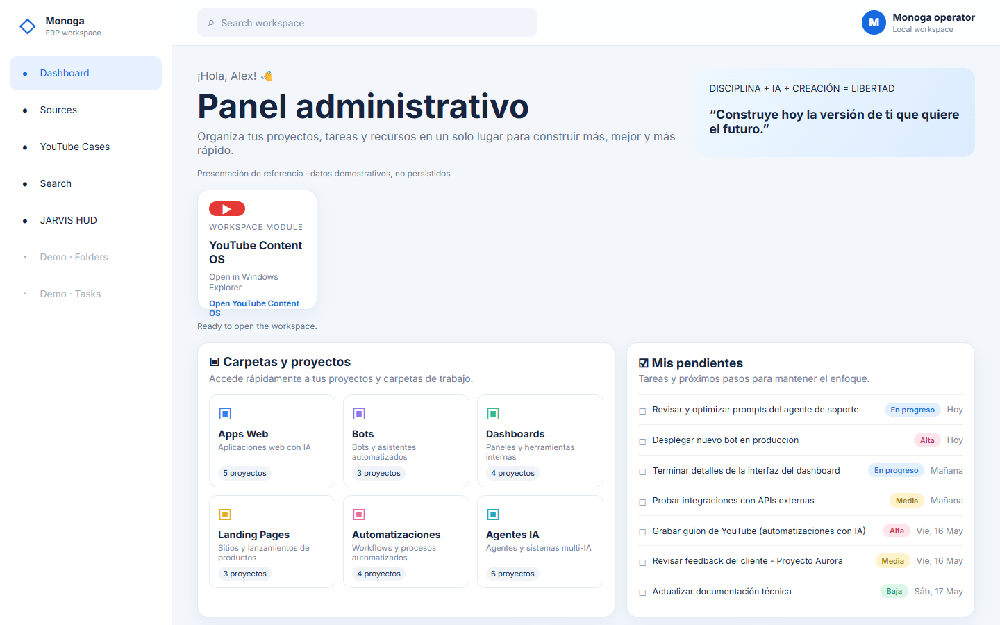
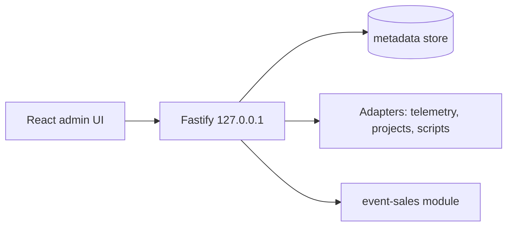

# Monoga ERP

A local-only operations console: a Fastify server and a React admin UI that bring project, telemetry and content data into one place, plus a consent-first lead module for live events.

**Why:** one personal dashboard for a one-person studio, bound to the owner's machine. Nothing is sent automatically; leads go to a human-review inbox.

## Screenshots



*Local-first ERP workspace dashboard with demo data.*

## Key features
- **Admin UI** (`src/client/`): dashboard, sources, YouTube cases, search, Jarvis HUD and an omnibar.
- **Local metadata store** (`src/metadata-store.ts`) behind Fastify routes (`src/app.ts`).
- **Adapters** for YouTube, viral scripts, workspace folders, projects and Jarvis telemetry (`src/*-adapter.ts`).
- **Event-sales module** (`src/event-sales/`): 10 pipeline stages, consent states (unknown, granted, declined), proposal approval states (draft, pending human review, approved, declined), and a deterministic demo harness with no network calls.
- **Loopback only**: the server binds to `127.0.0.1`.

## Architecture


## Stack
TypeScript, Fastify 5, React 19, Vite 8, Vitest 5.

## Structure
| Path | What it is |
|---|---|
| [src/](src/README.md) | Server, routes, metadata store and adapters |
| [src/client/](src/client/README.md) | React admin UI |
| [src/event-sales/](src/event-sales/README.md) | Lead, consent, proposal and demo module |
| [test/](test/README.md) | Vitest suites for stores, adapters and routes |

## Run
```bash
npm install
npm test && npm run typecheck && npm run build
PORT=4000 node dist/server.js
```

## Status
🟡 Early foundation (v0.1). The suite (20 test files) is present but was not re-run in this copy. Adapters assume a particular local workspace layout, so features need adjusting outside the author's machine.

---

Built by Monoga · [github.com/Monoga2025](https://github.com/Monoga2025)
