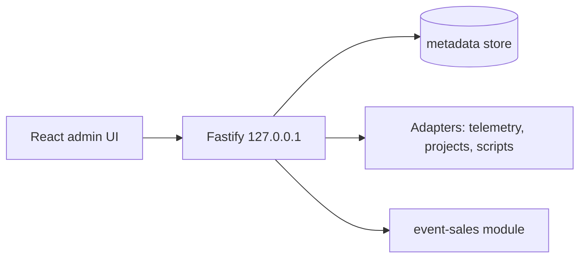

# Monoga ERP

Local-only ERP foundation: a Fastify server (bound to `127.0.0.1` only) with a React/Vite admin UI, a metadata store and adapters that read from other workspace modules (telemetry, scripts, projects). Includes an "event sales" MVP boundary: local lead capture with consent, diagnosis, demo catalog and human-review inbox, never auto-sending anything.

**Stack:** TypeScript, Fastify, React, Vite, Vitest.



## Run
```bash
npm install
npm test && npm run typecheck && npm run build
PORT=4000 node dist/server.js
```

## Status
Early foundation (v0.1). Adapters assume a particular local workspace layout, so several features need adjusting outside the author's machine. Tests were not re-run in this copy.
